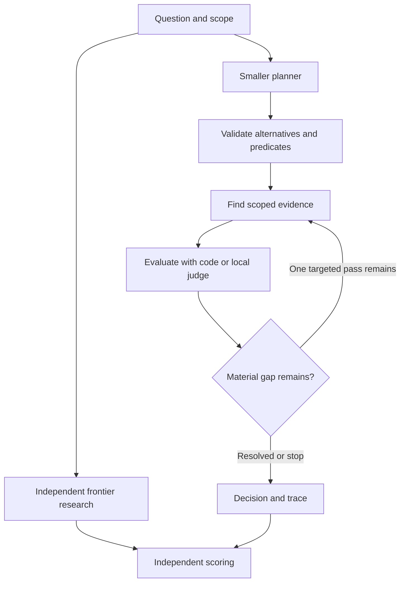

# Architecture and contracts

## Execution design

Use a single domain-neutral execution service for the UI, CLI, and benchmark runner. Keep benchmark scoring separate from the runtime. A provider adapter cannot see gold labels or another arm’s outputs. Store immutable run records and source snapshots locally. SQLite and files are reasonable defaults. Pick the smallest reliable implementation after inspecting the repository.

### Fresh path

1. **Frame the question.** Preserve its text. Record scope, effective date if applicable, allowed sources, alternatives, and material conditions. Ask for clarification or defer if an interpretation could change the conclusion and the supplied scope cannot resolve it.
2. **Plan around what separates the alternatives.** Generate the smallest set of material predicates, including exceptions that could reverse the answer. For each, record what evidence would settle it, which source types can supply that evidence, and what could defeat the leading conclusion. A bounded source index or supplied context can inform planning. Record any material decision criterion learned from sources separately from criteria supplied by the caller.
3. **Validate the plan.** Validate schema, operand references, type and operator compatibility, cycles, budgets, and scope. Check that each material condition maps to a predicate and that alternatives and exceptions are represented. Where a condition cannot be represented safely, use a bounded joint judgment or return a clear scope gap. Generated predicate and composition text remains data. Execute a closed set of registered operators and expression nodes.
4. **Bind evidence.** Prefer exact entity or identifier lookup when the source is structured. Use scoped text retrieval for semantic gaps. Resolve source authority, effective period, revision, and entity before evaluating. Preserve original excerpts, qualifiers, and competing evidence. Pass joint evidence to one predicate when separating it would change the question.
5. **Evaluate.** Use code for exact operations and the decision model for semantic checks. Track unknowns and conflicts separately. A missing input is unresolved. A check may be inapplicable only when the relevant applicability condition has been positively established. A source lookup failure establishes a negative finding only if a complete authoritative source was actually searched and its semantics allow that inference.
6. **Compose.** Implement three-valued composition for verified Boolean rules. For `AND`, a definitive false operand can settle the expression. For `OR`, a definitive true operand can settle it. A required unknown remains unknown when alternatives remain viable. Keep `not_applicable`, conflict, and technical failure distinct in the trace. Each composition must specify how those states map to its logic. For a multiple-choice outcome, define conditions per alternative and defer on unresolved ties or priorities. Use a model for joint judgments when they cannot be expressed as explicit rules. Raw scores from different predicates carry no assumed independence or calibrated joint meaning.
7. **Spend at most one extra retrieval round by default.** Identify the unresolved predicate or counterevidence that could still change the outcome. If a definitive conclusion holds across the remaining outcomes under the verified expression, stop and record why. A potential override stays in the reasoning until it is decided or proven irrelevant. Bound time, tokens, source calls, predicate count, and rounds. Reaching a budget cap yields a named stop reason and any material gap.

### Memory and versioning

Treat the knowledge base, reviewed programs, and judgments as separate record types. Knowledge keeps original sources and dated observations. The program library keeps reusable operations and reviewed program revisions. Working state and run history keep hypotheses, evidence packets, gaps, and model results. Prior outputs can point to evidence but cannot become authority through repeated retrieval.

For historical decisions, separately resolve **program and policy applicability**, **source validity**, and **when an observation was available** if the task is explicitly historical-as-known. Reject invalid dates, missing pinned versions, and future evidence when incompatible with the requested frame. A numeric policy parameter can change while program structure remains valid. A new requirement, exception, or scope boundary calls for reevaluation of the program. A replay uses the original pinned program, sources, request, and recorded outputs. A fresh execution against those inputs is a rerun and can differ if a model is nondeterministic.

### Records

| Record | Required content |
|---|---|
| `DecisionRequest` | Request ID, original question, caller criteria and alternatives if provided, scope, as-of date, knowledge snapshot, run mode and budget |
| `Plan` | Program ID or draft ID and revision, origin (`fresh`, `reviewed`, `curated`), intended outcome, applicability constraints, coverage mapping, predicate list, composition tree, and unresolved framing issues |
| `Predicate` | Stable ID within the plan, narrow question, outcome labels, evidence requirement, admissible source types and scope, applicability test, evaluator kind, dependencies, and role in composition |
| `EvidenceItem` | Source ID and revision, source title and locator, exact span or typed record value, snapshot ID, effective dates or observation time where known, and origin |
| `PredicateResult` | Predicate ID, normalized outcome, evidence references, gap or conflict, evaluator ID and revision, optional raw scores, measured call metadata |
| `DecisionResult` | Outcome (`decided`, `deferred`, `out_of_scope`, `failed`), answer if decided, decisive predicates, cited spans, missing facts and exceptions, skipped checks and reason, stop reason |
| `RunRecord` | Run and case IDs, stage and arm, input and plan revisions, source snapshot, model and prompt revisions, result and trace, timestamps, usage and cost status, retries, errors, and seed if supported |

`examples/decision_run.example.json` illustrates one result. Establish versioned validation schemas in code during the build. Keep answer labels distinct from status. Evidence IDs point to returned source spans, and validation checks membership and exact quotes before display. Independently evaluate support and applicability in the benchmark.

### Model adapters and local integration

- **Planner.** Generate schema-validated framing and predicates from the question and allowed context. Use stable prompts and record their hashes. Permit a bounded repair of malformed output and count it. Preserve the original user request for audit. Direct small-model RAG uses the same configurable small model, with a tuned direct-answer prompt and comparable source access.
- **Local judge.** Start with the owner’s working MLX/Unsloth `FastDecisionModel` setup. Load the model once in a resident local worker if feasible. Run the worker in its verified Python environment independently of the app if the dependencies differ. Confirm the adapter against the installed model and packages on the Mac. Use the proven binary support call first. Test any alternative output labels or multiple-choice schema before relying on them. Sufficiency and exact prerequisites are separate checks. A `false` support result alone does not distinguish contradiction from lack of support. Measure the fully serialized input with the actual tokenizer or validated counting path and handle overflow explicitly.
- **Frontier research.** Configure a named live model and tool route. Pass the same question and outcome contract. Record the actual evidence and tool trace that the provider exposes. Use an explicit unavailable state if the credentials or broad research feature are absent. A supplied-evidence run and a broad-research run are different conditions.
- **Offline control.** Use scripted and deterministic operators with clearly marked synthetic fixtures. Unexpected provider failures must surface as failures or declared retries. Switching to a fixture evaluator changes the run mode and must be explicit.

Prefer loopback-only binding for the initial app and worker. Keep secrets out of runs and fixtures. Ask for or configure source-sharing permissions at setup before sending any local evidence to a remote adapter. Treat retrieved text as untrusted input and separate it from instructions and tool permissions. Record provider timing, tokens, tool calls, pricing assumptions, and any unobservable costs separately.
