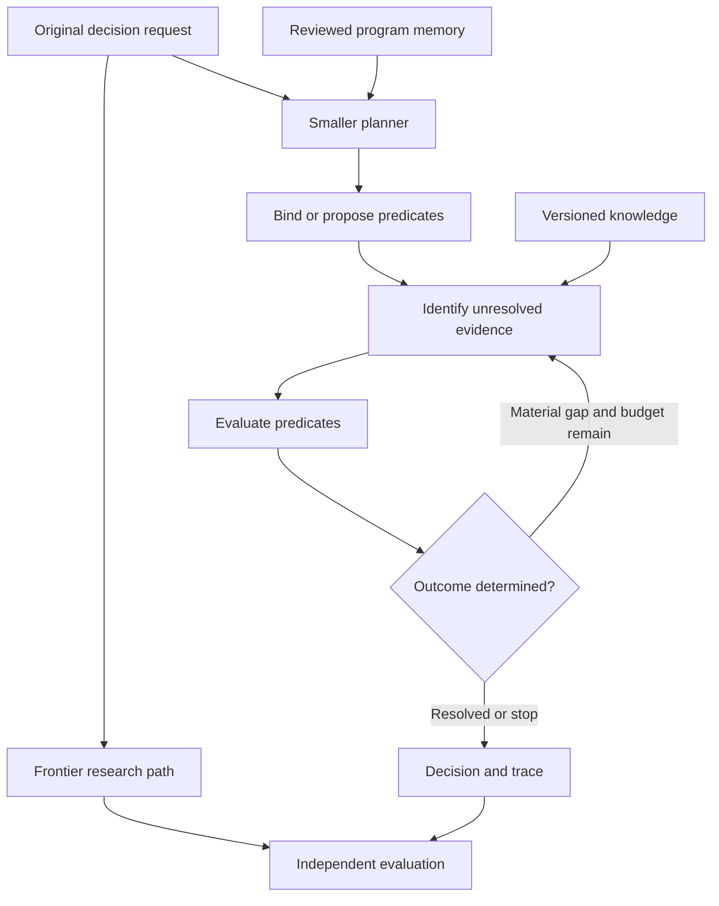

# Decision Program Research Scaffold

**Status** · Design draft. Implementation is on hold pending the additional area the project owner plans to bring in.

## Project question

Can we discover and verify how a family of decisions works once, then use a smaller generative planner, attached knowledge, and a local typed decision model to decide new instances from current evidence at lower cost and latency? The comparison is a frontier model that researches and answers each question independently with citations. The quality target is independently verified decisions at comparable coverage.

The unit of reuse is a **decision program**. It specifies which predicates determine the outcome, what each predicate must know, which rules govern composition, and how to handle exceptions and unresolved evidence. Individual decisions bind the program to the current question, facts, and rules. A reusable program may require revision when the decision logic changes. A new fact usually calls for a new evaluation of the affected predicates.

Three claims must be tested separately.

1. **Decomposition helps.** The smaller model reaches better decisions when it can resolve a collection of well-defined predicates instead of answering the entire question directly.
2. **Attached knowledge helps.** Providing the right facts and rules improves those judgments, particularly when the information is unavailable in the question or the model’s training.
3. **Reuse pays.** A verified program transfers to new instances, identifies its scope boundaries, and reduces work enough to recover the cost of discovering and maintaining it.

The first two can succeed while the third fails. If a small generative model with the same sources matches the full system, the added complexity needs another measured benefit to justify it.

## Design reasoning

From first principles, a decision requires a target, alternatives, criteria, facts, and a way to apply those criteria to the facts. Missing criteria, missing evidence, and inadequate reasoning are different problems. A system that can tell them apart can respond more appropriately and is easier to diagnose.

The second step is to assign each operation to a component with a clear job. Use generation for interpretation and proposing structure. Use retrieval to acquire evidence. Use the local judge where semantic judgment is needed. Use exact lookup, arithmetic, and explicit rule execution where applicable. The resulting ensemble is a set of cooperating predicates. Each can contribute a different necessary part of the answer.

The alien-goggles pass starts from possible outcomes and asks which observations distinguish them. That reverses the default order of searching for everything relevant and then trying to reach a conclusion. It also gives us tests for the system. Changing decisive evidence should move the result when warranted. Paraphrasing the request, adding a distractor, or duplicating a source should have little effect. Removing indispensable evidence should yield an unresolved result if no other evidence settles it.

Decomposing a problem can make local judgment easier, but a bad decomposition can omit an exception or separate facts whose interaction determines the answer. Preserve the original query, audit coverage of its material conditions, and keep coupled judgments together. Source sufficiency and the model’s ability to use sufficient evidence are separate failure modes. [Sufficient Context, ICLR 2025](https://research.google/pubs/sufficient-context-a-new-lens-on-retrieval-augmented-generation-systems-2/)

## Architecture

Both paths receive the same original question and stated criteria. The frontier path researches independently and returns a decision with sources. The smaller path uses a low or mid tier generative model, a bounded knowledge source, and one or more typed evaluators. Both return the same top-level decision and evidence fields. The smaller path also retains a predicate trace. Frontier answers and traces stay isolated from the smaller path during evaluation.

1. **Frame.** Identify the outcome sought, applicable criteria, alternatives, and time and scope constraints. Surface material ambiguity rather than choosing a convenient interpretation.
2. **Bind or decompose.** Match to a reviewed program and verify its scope, or propose a new program for this run. Map material conditions in the request to predicates. Detect unhandled alternatives, exceptions, cycles, and unsupported combining rules. Keep joint evidence in one predicate when the decision depends on interaction.
3. **Acquire.** Resolve exact facts through structured lookup. For semantic gaps, use bounded retrieval or a bounded context supplied to the planner. Request evidence that could discriminate among still-viable outcomes, including exceptions and counterevidence. Route unavailable observations and inaccessible sources to explicit gap states.
4. **Evaluate.** Give each evaluator the predicate, criteria, and relevant source excerpts or structured fields. Start with the working local `MaziyarPanahi/Qwen3.5-4B-Jev-Judge` for evidence support. Validate other predicate types before assigning them to it. Measure the full serialized prompt against the configured 4,096-token limit, including predicate text and output schema overhead where applicable. [Model card](https://huggingface.co/MaziyarPanahi/Qwen3.5-4B-Jev-Judge)
5. **Compose and stop.** Apply the reviewed rules to resolved and unresolved predicates. Evaluate independent branches in parallel when the runtime supports it. Continue retrieval only for a remaining gap that could change the outcome and fits the budget. Preserve the reason for stopping.
6. **Review and improve.** Inspect failures after evaluation. The frontier model may propose a missing predicate, exception, source requirement, or different representation during development. Verify proposals against sources and regression cases before promotion. Reserve new evaluation data after modifying a program in response to a failed holdout.

Research already explores using structured evidence gaps to guide retrieval. Our testable extension is whether **reviewed decision programs transfer across questions and reduce evidence acquisition while preserving quality**, especially after facts or rules change. [S2G-RAG, ACL 2026](https://aclanthology.org/2026.acl-long.1185/)

## Proposed contracts

These are design records for the later implementation. The smallest useful version should support one outcome with a few predicates and an explicit exception.

| Record | Required contents | Invariant |
|---|---|---|
| **Decision request** | Original question, alternatives or target outcome, stated criteria, scope, effective date, evidence access and budget | Keep the original text available for comparison with the planner’s interpretation. |
| **Decision program** | Program ID and revision, applicability and exclusions, predicate definitions, dependency edges, composition rule, fallback for unknown or conflicting inputs, review status | Apply a reused program only within its scope. Separate the program’s rule dependencies from facts that vary per instance. |
| **Predicate** | Single judgment or explicitly joint judgment, answer labels and definitions, required facts, source scope, evaluator kind, and downstream role | Every predicate has an explicit connection to the original decision. An unresolved required premise stays unresolved until evidence or a valid logical shortcut settles it. |
| **Evidence request** | Predicate ID, missing distinction, admissible source types, scope and version constraints, search budget | Tie retrieval to a gap that may affect an available outcome. |
| **Evidence item** | Source ID, exact location or record key, original span or typed value, relevant version and dates, source type and scope, linked predicate | Keep source text distinct from a model’s interpretation. Record shared origins when known so repeated excerpts do not count as independent support. |
| **Predicate result** | Typed value or unresolved status, evidence references, gaps or conflicts, evaluator and version, optional raw model scores | Keep raw scores separate from evidence sufficiency. A score has no calibrated interpretation until measured on the intended task. |
| **Decision result** | Outcome or deferral, governing rule, decisive predicates and sources, unresolved material items, stop reason, run metadata | The final result must follow from the recorded predicates and composition rule. |

For a symbolic composition such as `P1 AND P2 AND NOT P3`, the final positive outcome requires P1 and P2 to hold and evidence that the P3 exception does not apply. Failure to find the exception alone leaves P3 unknown unless the relevant source is known to be complete for that check. A verified false P1 can settle the overall result if the program has no override that can restore eligibility. Conflicting or out-of-scope evidence remains visible in the trace. Avoid pooling or multiplying predicate scores as if they were independent, particularly when the same model or sources were used.

## Attached memory

| Memory | Stores | Update behavior |
|---|---|---|
| **Knowledge** | Versioned reference material, rules, observations, scope, and effective dates | Preserve prior versions for replay. Mark dependent conclusions for review when material evidence changes. |
| **Reviewed programs** | Reusable predicates, applicability boundaries, source requirements, composition logic, and validation history | Promote reviewed revisions after regression checks. Preserve the prior version and its recorded scope. |
| **Working state and run history** | Current gaps, evidence packets, model judgments, resource usage, and traces | Carry uncertainty across steps. Prior model judgments remain labeled as judgments. A reviewed source or observation is required before promoting a claim into knowledge. |

A previous answer can accelerate search by pointing to prior evidence. Current applicability and source versions determine whether any of that evidence is still usable. The prototype can begin with explicit versioned source references and simple lookup. Add indexing or semantic search when the experiment needs it.

## Benchmark plan

Run two evaluations. **Practical comparison** gives the frontier model broad research access and the smaller system its intended bounded sources. This measures the actual speed, quality, and cost trade. **Controlled comparison** gives both paths the same frozen corpus and comparable evidence-access limits. This helps isolate interpretation and decision quality from source access. Hold the original question, criteria, and as-of date constant.

| Configuration | Question it helps answer |
|---|---|
| Frontier research model | What quality and resource cost does the research path achieve? |
| Smaller generative model with the same bounded retrieval | Does a direct answer already capture most of the achievable benefit? |
| Fresh predicate decomposition, with and without attached knowledge | What does external knowledge contribute when the decision structure is held constant? |
| Direct decision, with and without attached knowledge, on eligible questions | How much does decomposition contribute when the evidence access is matched? |
| Reviewed program with targeted retrieval | Does reusing the structure improve quality, time, or resource use on new instances? |
| Diagnostic runs with curated predicates and curated evidence, supplied separately and together | Is the bottleneck framing, retrieval and preparation, evaluation, or composition? |

Use independent labels and an evidence rubric. Review source validity, the applicability of rules, citation support, and whether the conclusion follows. Keep the reviewer blind to the method where feasible. Establish reference labels without treating the frontier model’s answer as ground truth. Include ambiguous or genuinely unanswerable questions with defensible unresolved labels.

Split by source and decision family where appropriate. Use held-out instances within known families to measure reuse. Hold out whole families to measure appropriate scope rejection or fresh decomposition. Keep versions and closely related variants together to avoid leakage. Include chronological cases to test changed rules and evidence. Predefine what counts as a material error, how appropriate deferrals are scored, and the acceptable trade between answer coverage and errors before opening the holdout.

| Measure | How to report it |
|---|---|
| **Decision quality** | Correctness, material errors, and deferral quality. Report error at comparable answer coverage, plus coverage on answerable and unresolved cases. |
| **Evidence quality** | Citation validity and applicability, decisive evidence found or missed, and whether supported predicates actually justify the outcome. |
| **Robustness** | Paired response to decisive edits, missing evidence, negation, distractors, overlapping sources, and scope violations. |
| **Time and resources** | End-to-end latency with cold and warm runs separated, source calls, tokens, judge invocations, and local resource use. Include retrieval, retries, and any frontier fallback. |
| **Economics of reuse** | Separate program discovery, review, and maintenance from per-query costs. Report observed recurring volumes and when cumulative savings could repay setup. |

The cost comparison should put discovery and maintenance on the reuse side of the ledger. Under a simple constant-cost approximation, break-even volume is `program setup and maintenance cost / (frontier cost per query − full smaller-path cost per query)`, provided the denominator is positive. Use observed costs, include escalation in the smaller-path cost when enabled, and keep cash costs distinct from local compute and review time when a common valuation has not been agreed.

## Proposed project layout

The eventual layout below names responsibilities. This scaffold is a design document and the directories are proposals.

| Area | Responsibility |
|---|---|
| `contracts/` | Request, program, evidence, predicate result, and run schemas |
| `planner/` and `programs/` | Generative decomposition, scope checks, and reviewed program definitions |
| `knowledge/` | Versioned corpus, retrieval adapters, source verification, and evidence packets |
| `runtime/` and `evaluators/` | Scheduling, exact checks, local judge adapter, composition, and stopping |
| `benchmark/` | Isolated frontier baseline, paired comparisons, trace capture, and metrics |
| `fixtures/` | Small symbolic cases with known labels, source changes, and dependency behavior |
| `docs/` | Decisions, benchmark protocol, failure analysis, and extension rationale |

## Build sequence after the hold

1. **Confirm the scope.** Integrate the pending area and update the hypothesis, contracts, or comparison where it has a measurable effect. Decide whether it belongs in the initial experiment or in a later comparison arm.
2. **Verify the simplest complete loop.** Use a hand-authored program and curated source packets. Show a resolved path, an unresolved exception, and a changed source. Replay each result from its recorded inputs and composition rules.
3. **Replace one curated component at a time.** Add actual local inference, then retrieval, then generative decomposition. Use the curated version as a diagnostic control after each replacement.
4. **Run the independent comparison.** Freeze the rubric, models, prompts, corpora, and holdout before the measured run. Review paired failures, coverage, and costs. Decide whether to retain the full pipeline, keep a simpler component, or revise the hypothesis.
5. **Test reuse.** Evaluate repeat decisions with new inputs, one governed rule change, and one unfamiliar family. Estimate amortized cost only after measuring program setup, verification, and maintenance.

## Extension intake and resume point

The additional area is intentionally open. When supplied, record **what new capability it contributes, which information it consumes or produces, which decisions it may change, and what comparison would show that it helps**. Evaluate whether it changes the decision representation, supplies a new form of memory, adds an evaluator, changes how predicates compose, or belongs in the learning or benchmark loop. If it changes the core premise, revise the scaffold before committing to the project layout or baseline.

**Hold point** · Resume with the extension intake and scope review. Implementation and benchmark execution await the project owner’s next direction.
